# Решение хакатона

Команда: AXIOM

## Описание решения

Разработали веб-сервис и приложение на Android для отслеживания состояния зелёных насаждений в городской среде.

## Функции

-   🔍 Анализ растений по фото - автоматическое определение видов и диагностика здоровья
-   🌳 Детальная диагностика - оценка состояния, биометрические параметры, выявление болезней
-   📊 Индекс повреждённости - комплексная оценка по множеству параметров (дупла, трещины, сухие ветви)
-   🗺️ Интерактивная карта - визуализация всех наблюдений с метками состояния
-   📈 Статистика и отчёты - детальная аналитика по каждому растению
-   💾 История исследований - хранение всех анализов в виде карточек с фотографиями
-   🖼️ Галерея снимков - архив всех загруженных фото с быстрым доступом к статистике

## Демонстрация

Стартовая страница сайта с общим описанием проекта:

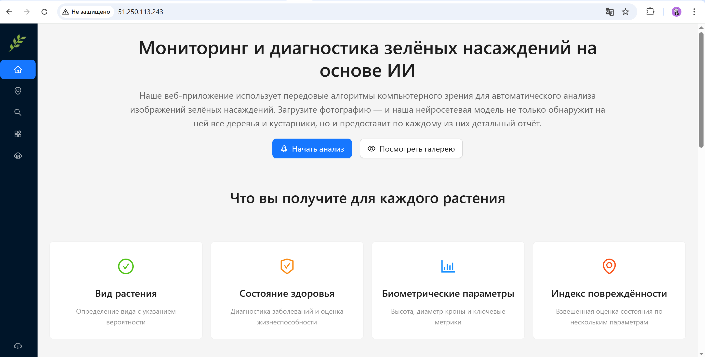

Можно перейти в галерею, где будут отображены все загруженные фотографии:

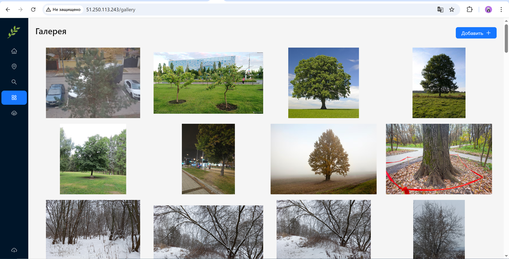

Для каждого дерева можно перейти в подробное описание, нажав на фото. В таком режиме будут видны все предсказанные характеристики:

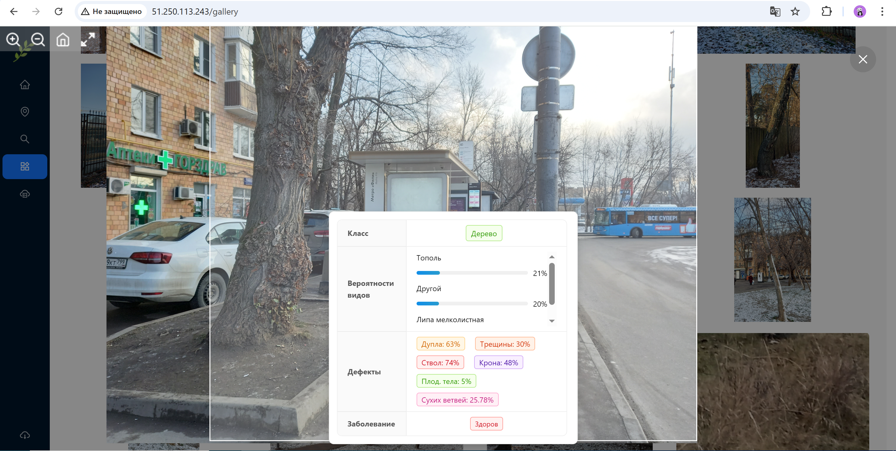

Также можно перейти во вкладку с исследованиями. Исследования в себе объединяют группу фотографий:

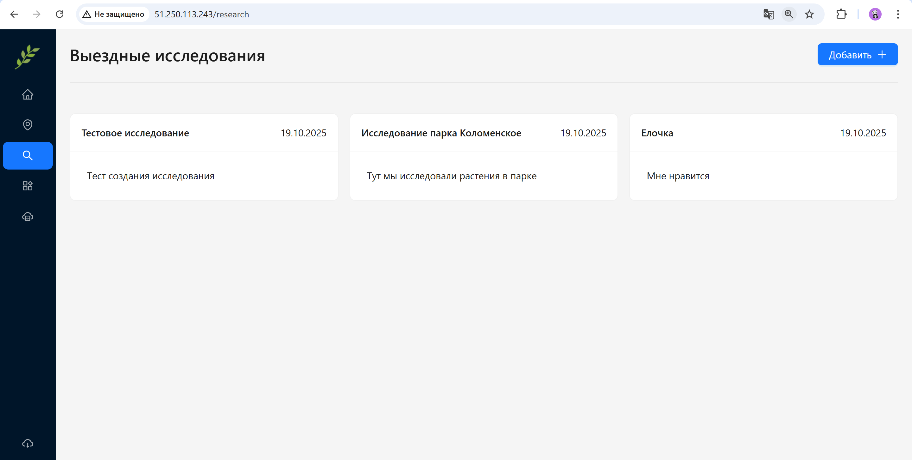

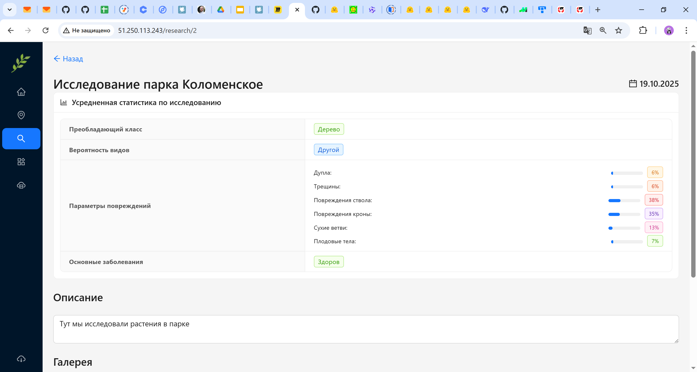

Есть раздел с картами, где можно смотреть состояния каждого дерева, отмеченного на карте, или смотреть состояния по областям:

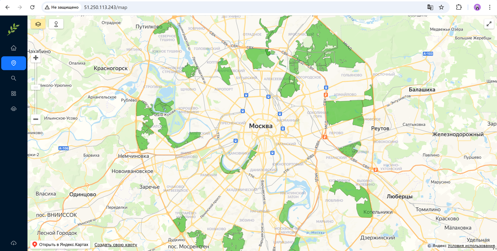

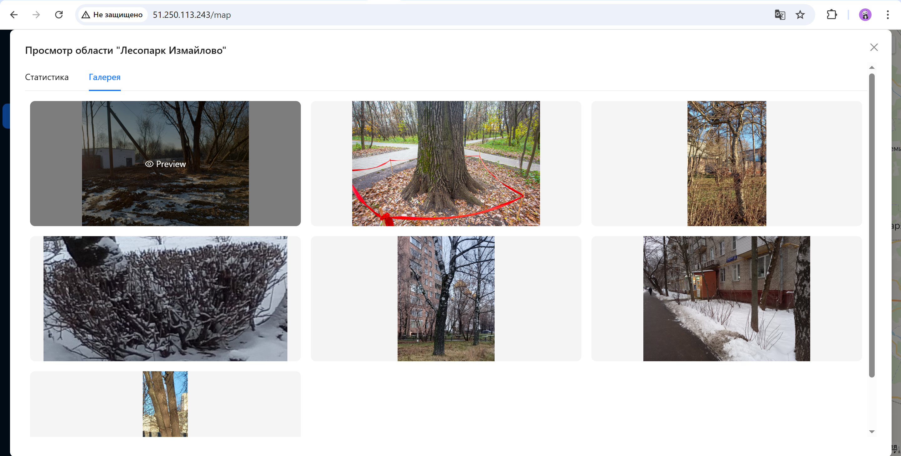

Также точечная карта:

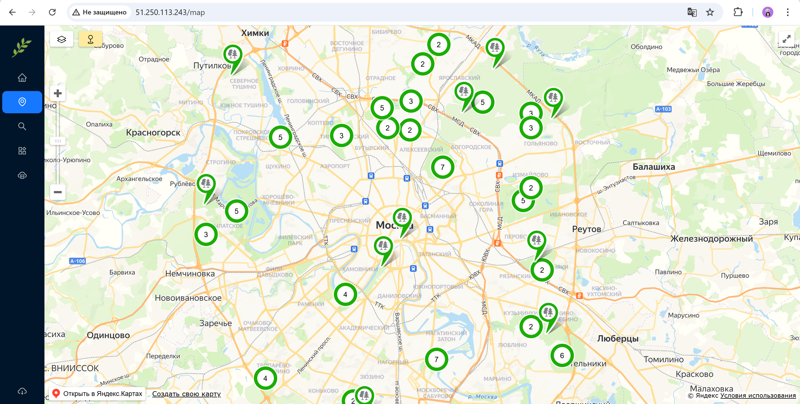

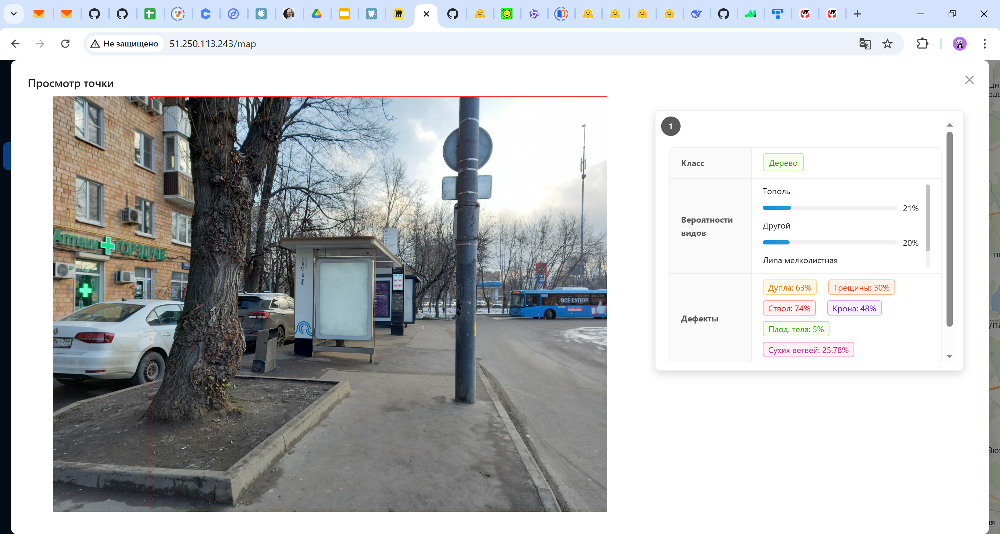

Каждый пользователь может размечать загруженные фотографии, чтобы впоследствии дообучать моделью Делается это путём создания датасета:

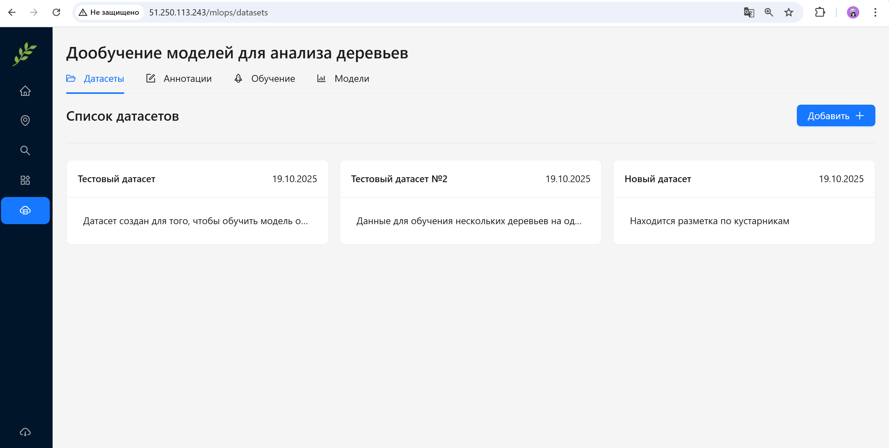

Каждое фото в датасете пользователь может разметить - указать рамки дерева, его характеристики, породы, и наличие болезни:

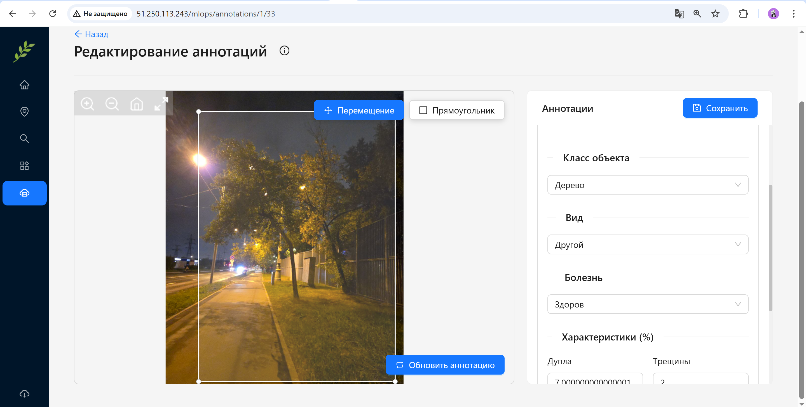

После разметки датасета пользователь может дообучить модель, выбрав какую часть хочет дообучить:

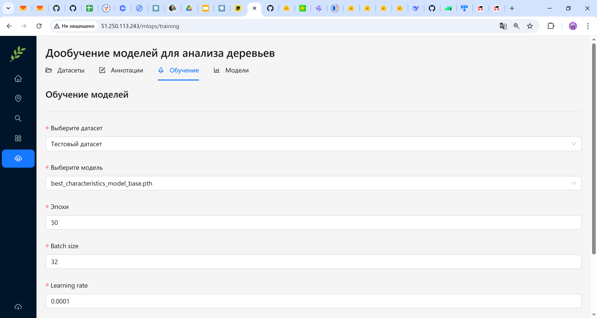

Дальше пользователь может выбирать какую модель использовать для определения характеристик деревьев:

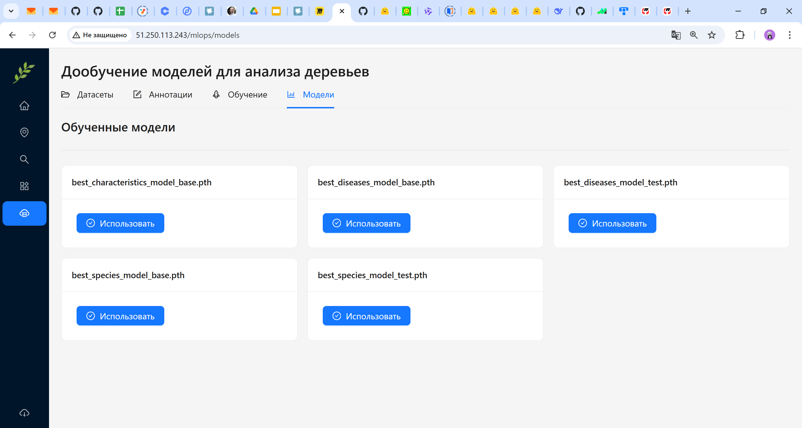

## Структура проекта

- frontend: веб версия нашего приложения + инструкция по разворачиванию
- backend: вся бэкенд часть, состоящая из 2 сервисов + инструкция по разворачиванию
- mobile: код мобильной версии приложения
- experiments: код с сбором данных и обучения моделей компьютерного зрения