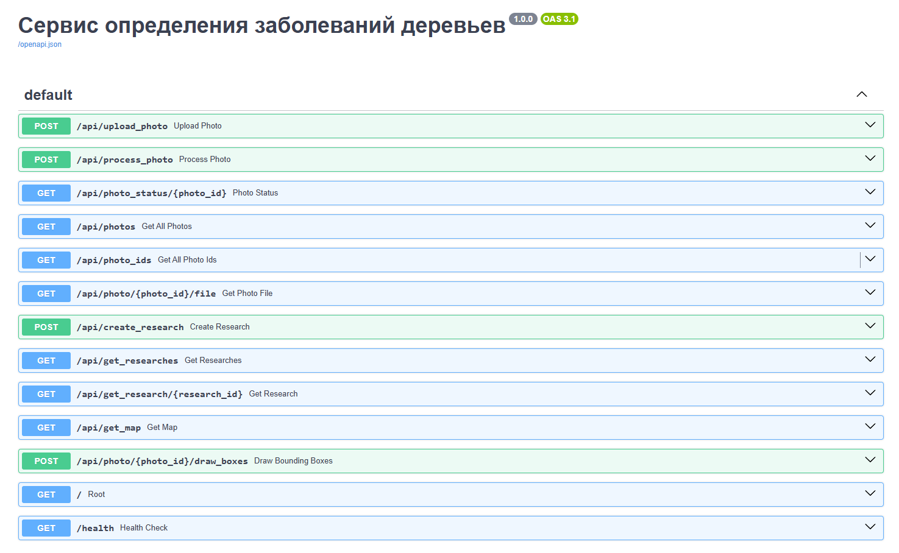

# Backend-часть

## Описание

Весь бэкенд представлен двумя сервисами: 

1) бэкенд для сохранения изображений и общения с базой данных
2) бэкенд с инференсом моделей для обработки изображений

## Документация

Документация по использовани backend части преставлена в Swagger:



Можно посмотреть по http://localhost:8000/docs/ после развёртывания приложения.

## Инструкция по разворачиванию приложения

### 1. Установите Docker и Docker Compose

Для Ubuntu/Debian:

```bash
# Обновление пакетов
sudo apt update

# Установка Docker
sudo apt install docker.io

# Установка Docker Compose
sudo apt install docker-compose

# Добавление пользователя в группу docker
sudo usermod -aG docker $USER
```

Для CentOS/RHEL:

```bash
# Установка Docker
sudo yum install docker

# Установка Docker Compose
sudo curl -L "https://github.com/docker/compose/releases/download/1.29.2/docker-compose-$(uname -s)-$(uname -m)" -o /usr/local/bin/docker-compose
sudo chmod +x /usr/local/bin/docker-compose

# Запуск Docker
sudo systemctl start docker
sudo systemctl enable docker
```


### 2. Проверка установки

```bash
docker --version
docker-compose --version
```

### 3. Запуск приложения

```bash
# Запуск всех сервисов
docker-compose up -d
```

### 4. Проверка работы

Проверку работы backend-приложения можно проверить перейдя, например, на страницу документации: http://localhost:8000/docs
